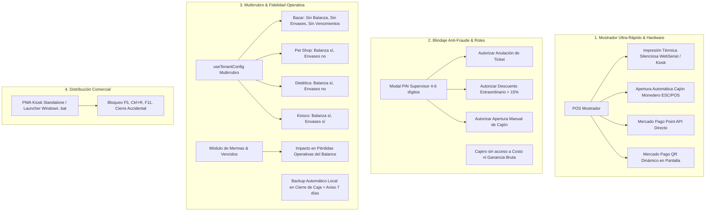
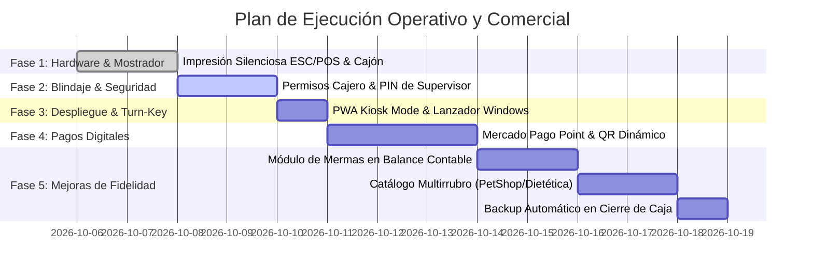

# Plan de Implementación: Operatividad y Comercialización — KioscoPOS

> **Objetivo:** Transformar KioscoPOS de una plataforma tecnológicamente sólida en un **producto 100% operativo en mostrador de alta velocidad y comercialmente listo para venta masiva (SaaS / Licencias)**.
> **Alcance:** 4 Módulos Nuevos de Alta Prioridad + 3 Mejoras de Fidelidad a Módulos Existentes.
> **Base de Código:** React 19 + TypeScript + Vite + Tailwind v4 + Supabase + Dexie/IndexedDB + Vitest (352 tests pasando).

---

## 🗺️ Diagrama de Arquitectura de la Nueva Fase



---

## 📋 Resumen de Módulos a Desarrollar

| # | Módulo / Requisito | Tipo | Impacto Principal | Archivos Clave Involucrados |
|---|---|:---:|---|---|
| **1** | **Impresión Térmica Silenciosa & Cajón Monedero** | Nuevo | Elimina el diálogo de impresión y abre el cajón con efectivo | `src/lib/escposPrinter.ts`, `PaymentModal.tsx`, `TicketReceiptModal.tsx`, `ConfigPage.tsx` |
| **2** | **Seguridad en Mostrador & PIN de Supervisor** | Nuevo | Protege costos y exige PIN para anulaciones, descuentos o cajón | `src/components/auth/SupervisorPinModal.tsx`, `CatalogoPage.tsx`, `StockPage.tsx`, `ReportesPage.tsx` |
| **3** | **Empaquetado Escritorio / PWA Turn-Key** | Nuevo | Modo quiosco pantalla completa a prueba de fallas para Windows | `vite.config.ts`, `public/manifest.json`, `src/App.tsx`, scripts de inicio Windows |
| **4** | **Mercado Pago Point & QR Dinámico** | Nuevo | Cobro digital desatendido sin tipeo manual ni fraudes | `src/lib/mercadopagoPoint.ts`, `PaymentModal.tsx`, `ConfigPage.tsx` |
| **5** | **Mermas, Vencidos y Roturas Fidedigno** | Mejora | Diferencia roturas y vencimientos e impacta el balance | `src/pages/StockPage.tsx`, `src/components/reportes/BalanceContableTab.tsx` |
| **6** | **Catálogo Adaptable Pet Shop / Dietética / Veterinaria** | Mejora | Desactiva envases y adapta balanza/vencimientos por rubro | `src/hooks/useTenantConfig.ts`, `src/types/database.ts`, `ImportarCatalogoModal.tsx` |
| **7** | **Copia de Seguridad Integral Automatizada** | Mejora | Respaldo automático semanal en cierre de caja + configuración | `src/lib/backupUtils.ts`, `src/pages/ConfigPage.tsx`, `cajaStore.ts` |

---

## 🛠️ Especificación Técnica Detallada

### 1. Impresión Térmica Silenciosa y Apertura de Cajón Monedero

#### Problemática Operativa
Actualmente, el cobro dispara `window.print()` requiriendo que el cajero confirme con `Enter` en cada venta. En hora pico con fila de clientes, esto retrasa el despacho y obliga a abrir el cajón monedero con llave manual.

#### Solución a Implementar
1. **Doble canal de impresión silenciosa**:
   - **Canal A (Web Serial API direct):** Utiliza [`escposPrinter.ts`](file:///x:/Programaci%C3%B3n/kiosco-app/src/lib/escposPrinter.ts) para enviar buffers binarios ESC/POS directamente a la impresora USB/COM seleccionada. El puerto serial se solicita una única vez y queda persistido en `localStorage` / `navigator.serial.getPorts()`.
   - **Canal B (Kiosk Printing nativo):** Para impresoras instaladas por driver de Windows (Epson, Hasar, POS-58, POS-80), soporte transparente de impresión desatendida mediante el flag `--kiosk-printing` de Chromium sin diálogo de confirmación.
2. **Apertura de cajón monedero por pulso eléctrico**:
   - Enviar la secuencia estándar ESC/POS `CMD_KICK_DRAWER = [0x1b, 0x70, 0x00, 0x19, 0xfa]` (Pin 2 y Pin 5).
   - **Disparo automático:** Inmediatamente al confirmar una venta cobrada con `EFECTIVO` (o pago mixto que incluya efectivo).
   - **Disparo manual:** Botón *"Abrir Cajón"* disponible en la barra de herramientas del POS (protegido por PIN de supervisor si el usuario es `CAJERO`).
3. **Preferencias en Configuración (`ConfigPage.tsx` - Solo DUEÑO)**:
   > [!IMPORTANT]
   > **Diseño Defensivo (Desactivado por defecto):** Si el comercio no dispone de impresora térmica o cajón monedero, estas funciones inician **desactivadas (`false`)** para garantizar que el cobro sea 100% fluido y libre de errores de conexión o diálogos molestos en cualquier dispositivo (notebooks, tablets, PCs de oficina). Solo se activan cuando el dueño conecta físicamente el hardware y lo habilita voluntariamente.
   - **Toggle 1: `impresion_termica_silenciosa_activa` (Default: `false`):**
     - Si está `false`: La venta se cobra inmediatamente sin diálogo ni peticiones de puertos. El cajero puede ver el ticket en pantalla o imprimirlo manualmente solo si el cliente lo solicita.
     - Si está `true`: Envía los comandos ESC/POS silenciosos automáticamente al confirmar la venta.
   - **Toggle 2: `apertura_cajon_monedero_activa` (Default: `false`):**
     - Si está `false`: No se envía pulso eléctrico ni se solicita puerto serial al pagar en efectivo.
     - Si está `true`: Envía el pulso `CMD_KICK_DRAWER` automáticamente en cobros en efectivo (o pagos mixtos con parte en efectivo).
   - **Selector de método:** `Térmica Directa Web Serial (USB/COM)` vs `Driver Windows / Kiosk Mode`.
   - **Herramientas de diagnóstico en pantalla:**
     - Botón *"Probar Impresión Térmica"*: emite un ticket corto de prueba sin registrar ninguna venta.
     - Botón *"Probar Apertura de Cajón"*: dispara el pulso eléctrico para verificar el solenoide del cajón monedero.

---

### 2. Seguridad en Mostrador: Permisos Granulares y PIN de Supervisor

#### Problemática Operativa
El dueño no puede delegar la caja con tranquilidad si el cajero puede ver el costo de los productos, la rentabilidad neta del negocio, o si puede anular tickets y aplicar descuentos indiscriminados sin auditoría.

#### Solución a Implementar
1. **Ocultamiento de datos sensibles para rol `CAJERO`**:
   - En [`CatalogoPage.tsx`](file:///x:/Programaci%C3%B3n/kiosco-app/src/pages/CatalogoPage.tsx): ocultar columnas `Precio Costo` y `% Margen`.
   - En [`StockPage.tsx`](file:///x:/Programaci%C3%B3n/kiosco-app/src/pages/StockPage.tsx): ocultar KPI `Valor Inventario a Costo` y columna `Costo Unitario`.
   - En comprobantes y tickets: asegurar que nunca se expongan datos de costo ni ganancia.
2. **PIN Maestro de Supervisor en Base de Datos**:
   - Columna en tabla `kioscos`: `pin_supervisor` (string de 4 a 6 dígitos numéricos cifrado o hasheado).
   - Configuración en `ConfigPage.tsx` (sección Seguridad): solo accesible por `DUEÑO` para definir o cambiar el PIN.
3. **Componente Reutilizable `SupervisorPinModal.tsx`**:
   - Renderiza un teclado numérico táctil en pantalla (apto touch y teclado físico).
   - Solicita el PIN del supervisor o la contraseña del dueño para desbloquear acciones críticas:
     - **Acción A: Anulación de ventas:** en `ReportesPage.tsx` y en el historial de tickets.
     - **Acción B: Descuentos manuales extraordinarios:** si el cajero intenta aplicar un descuento manual superior al umbral configurado (ej: > 15%).
     - **Acción C: Apertura manual de cajón sin venta:** botón *"Abrir Cajón"* en mostrador.
     - **Acción D: Modificación de precio unitario en caliente:** si el cajero altera el precio de lista de un ítem en el carrito.

---

### 3. Empaquetado como Aplicación de Escritorio / PWA Turn-Key

#### Problemática Operativa
En una computadora de caja de Windows, los empleados pueden minimizar la ventana, abrir YouTube, navegar por internet o cerrar el navegador con la cruz superior por error, interrumpiendo el cobro.

#### Solución a Implementar
1. **Configuración PWA Standalone y Kiosk Ready**:
   - En `manifest.json`:
     ```json
     {
       "display": "standalone",
       "display_override": ["window-controls-overlay", "standalone"],
       "start_url": "/?source=pwa",
       "orientation": "landscape"
     }
     ```
2. **Script de Arranque Automático para Windows (`Lanzar-KioscoPOS.bat` / `.vbs`)**:
   - Script empaquetado en la carpeta del proyecto para crear un acceso directo en el escritorio y en la carpeta `Inicio` de Windows (`shell:startup`):
     ```bat
     @echo off
     start msedge.exe --app="http://localhost:5173" --kiosk --kiosk-printing --disable-pinch --no-first-run
     ```
   - Abre la aplicación a pantalla completa real, sin barra de direcciones, sin botones de cerrar y con impresión térmica silenciosa activada.
3. **Blindaje de Atajos de Teclado en Mostrador (`POSPage.tsx`)**:
   - Interceptar y deshabilitar teclas peligrosas durante la jornada:
     - `F5` y `Ctrl+R` (prevenir recargas accidentales durante un cobro).
     - `F11` (evitar salir de pantalla completa).
     - `Ctrl+W` y `Alt+F4` (prevenir cierre inesperado de la terminal).

---

### 4. Integración de Cobro con Mercado Pago Point & QR Dinámico

#### Problemática Operativa y Decisión del Comerciante
El 70% de las ventas en comercios urbanos se realizan con dinero digital o tarjetas. Sin embargo, muchos dueños de kiosco y bazar prefieren usar su propio Posnet independiente (Clover, Payway, Getnet, o terminal Point sin vincular) o su código QR impreso en mostrador, sin atarse a APIs externas.

> [!IMPORTANT]
> **Soberanía del Dueño (Desactivado por defecto):**
> Esta integración estará **desactivada (`false`) por defecto**.
> - **Modo Manual Tradicional (Default):** El cajero selecciona `MERCADOPAGO` o `TARJETA`, cobra en su Posnet o QR físico habitual y confirma la venta en el POS con 0 llamadas a APIs externas, sin esperas de red y sin configuraciones obligatorias.
> - **Modo Integrado Automatizado (Opcional):** El dueño puede ingresar a `ConfigPage.tsx` y activar voluntariamente el envío automático de montos a su terminal Point o la generación de QR dinámico.

#### Solución a Implementar
1. **Configuración en `ConfigPage.tsx` (Pestaña "Medios de Pago" - Solo DUEÑO)**:
   - **Toggle 1: `mercadopago_point_activo` (Default: `false`):** activa el envío de cobros por API a la maquinita.
   - **Toggle 2: `mercadopago_qr_dinamico_activo` (Default: `false`):** activa el QR dinámico con monto en pantalla.
   - Campo: `Mercado Pago Access Token` (solo visible si se activa alguna opción).
   - Campo: `Device ID Terminal Point` (ej: `PAX_A910__12345678`).
   - Campo: `External POS ID` (para QR dinámico).
2. **Flujo Mercado Pago Point (Terminal Inteligente Smart/Plus)**:
   - Si está activado: al seleccionar `MERCADOPAGO` en [`PaymentModal.tsx`](file:///x:/Programaci%C3%B3n/kiosco-app/src/components/pos/PaymentModal.tsx), el POS envía la intención de cobro por API:
     ```ts
     POST https://api.mercadopago.com/point/integration-api/devices/{device_id}/payment-intents
     { "amount": total, "additional_info": { "external_reference": venta_id } }
     ```
   - La terminal física solicita la tarjeta con el importe exacto.
   - El POS muestra un modal de espera con botón *"Cancelar cobro"* y monitorea el estado (`OPEN` → `PROCESSING` → `SUCCESS`).
   - Al detectarse `SUCCESS`, se cierra la venta y se emite el ticket automáticamente.
   - Si falla la conexión con Mercado Pago o el cajero cancela: botón de rescate inmediato *"Cobrar en modo manual"* para no trabar la venta.
3. **Flujo QR Dinámico en Pantalla (Transferencias 3.0 / MP)**:
   - Si está activado: genera una orden QR con el monto exacto en pantalla. El cliente escanea con su billetera virtual y el POS valida la acreditación al instante.

---

### 5. Modificación: Módulo de Mermas, Vencidos y Roturas Fidedigno

#### Mejoras sobre lo Existente
1. **Tipificación estricta de mermas en `movimientos_stock`**:
   - Actualmente los egresos son genéricos. Se añade la clasificación obligatoria:
     - `ROTURA` (mercadería dañada en depósito o salón).
     - `VENCIMIENTO` (perecedero caducado retirado de stock).
     - `CONSUMO_INTERNO` (bebida, comida o librería consumida por empleados/dueño).
     - `ROBO_O_PERDIDA` (diferencia negativa detectada en auditoría).
2. **Interfaz de Baja Ágil en `StockPage.tsx`**:
   - Pestaña o modal directo *"Registrar Merma"*.
   - Si el producto tiene lotes FEFO habilitados, permite seleccionar de qué lote específico se descarta la mercadería vencida.
3. **Impacto Contable en `BalanceContableTab.tsx`**:
   - Las mermas no deben figurar como faltante de dinero de caja ni como venta a $0.
   - Se reflejan en el **Libro Diario y en el Resumen Financiero** en una nueva línea:
     `(-) Pérdidas Operativas por Mermas: -$XX.XXX` valuadas a precio de costo unitario, deduciéndose de la ganancia operativa para un balance contable 100% fidedigno para el contador.

---

### 6. Modificación: Catálogo Maestro Multirrubro Adaptable (Pet Shop, Dietética, Veterinaria, Bazar)

#### Mejoras sobre lo Existente
1. **Ampliación de `RubroComercio` en [`src/types/database.ts`](file:///x:/Programaci%C3%B3n/kiosco-app/src/types/database.ts)**:
   ```ts
   export type RubroComercio =
     | 'KIOSCO'
     | 'FOTOCOPIADORA_LIBRERIA'
     | 'PETSHOP_VETERINARIA'
     | 'DIETETICA'
     | 'BAZAR'
     | 'GENERAL'
   ```
2. **Ajuste Dinámico en [`useTenantConfig.ts`](file:///x:/Programaci%C3%B3n/kiosco-app/src/hooks/useTenantConfig.ts)**:
   - **`BAZAR` (Bazar, Regalería y Hogar):**
     - `tieneEnvases = false` (desactiva completamente retornables).
     - `tieneBalanza = false` (artículos vendidos por unidad; vajilla, bazar, plásticos, regalería).
     - `tieneVencimientos = false` (productos no perecederos; oculta lotes FEFO y alertas de caducidad).
     - `tieneServiciosRapidos = false`.
     - `tipoComercioLabel = 'Bazar y Regalería'`, `etiquetaLocal = 'Bazar'`.
   - **`PETSHOP_VETERINARIA`:**
     - `tieneEnvases = false` (desactiva totalmente retornables en POS, carrito y sidebar).
     - `tieneBalanza = true` (alimentos balanceados y golosinas sueltas para mascotas).
     - `tieneVencimientos = true` (vacunas, antiparasitarios, pipetas y alimentos).
     - `tipoComercioLabel = 'Pet Shop y Veterinaria'`, `etiquetaLocal = 'Pet Shop'`.
   - **`DIETETICA`:**
     - `tieneEnvases = false` (sin botellas retornables).
     - `tieneBalanza = true` (frutos secos, harinas, cereales, semillas por peso).
     - `tieneVencimientos = true` (productos orgánicos y naturales perecederos).
     - `tipoComercioLabel = 'Dietética y Almacén Natural'`, `etiquetaLocal = 'Dietética'`.
   - **`FOTOCOPIADORA_LIBRERIA`:**
     - `tieneEnvases = false`, `tieneBalanza = false`, `tieneVencimientos = false`, `tieneServiciosRapidos = true`.
   - **`KIOSCO`:**
     - `tieneEnvases = true`, `tieneBalanza = true`, `tieneVencimientos = true`.
3. **Catálogo Maestro Adaptable (`ImportarCatalogoModal.tsx`)**:
   - Al seleccionar Pet Shop, Dietética o Bazar, suprimir automáticamente cervezas, cigarrillos y envases retornables.
   - Para Bazar: categorías modelo como *Cocina & Vajilla, Decoración & Regalería, Organización & Limpieza, Baño, Juguetería*.

---

### 7. Modificación: Copia de Seguridad Integral Automatizada

#### Mejoras sobre lo Existente
1. **Ampliación del contenido de [`backupUtils.ts`](file:///x:/Programaci%C3%B3n/kiosco-app/src/lib/backupUtils.ts)**:
   - Incluir la configuración del kiosco (datos fiscales, preferencias de impresora, alícuotas).
   - Incluir snapshot de saldos de cuentas corrientes de clientes y cuentas por pagar de proveedores.
2. **Respaldo Local Automático en Cierre de Caja**:
   - Al confirmar el arqueo de cierre de turno en [`cajaStore.ts`](file:///x:/Programaci%C3%B3n/kiosco-app/src/stores/cajaStore.ts), generar automáticamente una copia compacta en `IndexedDB` local (`backups_locales_kiosco`).
3. **Alerta Preventiva de Seguridad (Aviso 7 días)**:
   - Si transcurren más de 7 días sin que el dueño descargue una copia de seguridad externa (archivo `.json` o Excel maestro), mostrar un banner sutil pero claro en el panel de Configuración y Dashboard:
     *"Hace más de 7 días que no descargás una copia de seguridad externa. Recomendamos descargar un respaldo a un pendrive o disco externo."*

---

## 📅 Cronograma y Secuencia de Ejecución



---

## ✅ Criterios de Aceptación y Verificación

1. **Hardware Térmico & Cajón (Desactivado por defecto):** Las funciones de impresión silenciosa y apertura de cajón deben iniciar desactivadas (`false`) por defecto. Si están desactivadas, el cobro opera de forma 100% limpia sin errores ni peticiones de puertos en cualquier dispositivo. Al activarse voluntariamente por el dueño en Configuración, el cobro en efectivo imprime directamente y abre el cajón monedero sin abrir ventanas emergentes.
2. **Seguridad y PIN:** Un usuario con rol `CAJERO` no debe ver precios de costo ni márgenes en ninguna pantalla. Cualquier intento de anular un ticket o aplicar un descuento > 15% debe bloquear la acción hasta ingresar el PIN de supervisor válido.
3. **Modo Quiosco:** El lanzador de escritorio debe abrir la aplicación a pantalla completa sin elementos del navegador ni recargas accidentales con `F5`.
4. **Mercado Pago & Posnet (Desactivado por defecto):** El cobro digital opera en modo manual tradicional por defecto (compatible con cualquier Posnet independiente o QR de mostrador sin integración). Solo si el dueño activa la integración Point/QR en Configuración, el sistema envía los montos a la terminal o despliega el QR dinámico en pantalla, contando siempre con botón de rescate manual.
5. **Multirrubro (Pet Shop, Dietética, Bazar):** Al configurar un comercio como Pet Shop, Dietética o Bazar, la recepción de envases debe desaparecer por completo del POS y del menú lateral. En Bazar, además, se suprimen pesables y vencimientos FEFO para máxima simpleza de mostrador.
6. **Tests y Compilación:** Todas las 352 pruebas existentes deben continuar pasando al 100%, más las nuevas pruebas unitarias para cada módulo incorporado.
