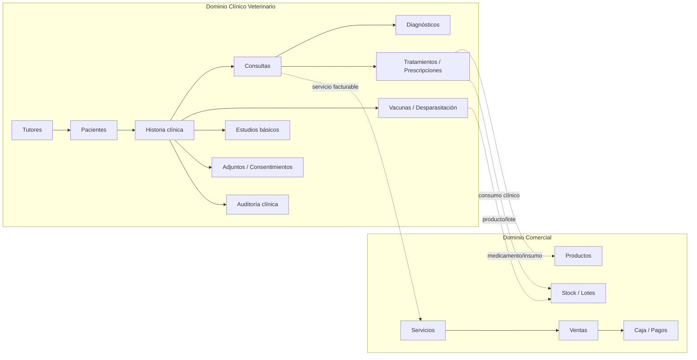

# KioskoPOS — revisión del plan operativo y comercial

**Estado actualizado: 10/10/2026.** Implementación en curso. El registro siguiente
es el resumen vigente; la evaluación original del 05/10 y las notas de avance
del final se conservan como historial. Sus conteos y menciones de publicación
pendiente describen aquella ejecución, no el estado actual.

## Registro de tareas pendientes

Una tarea pendiente puede requerir desarrollo, aplicación SQL, aceptación
remota o prueba física. Una implementación local no cierra su fase hasta
cumplir la puerta de aceptación correspondiente.

| ID | Fase | Tarea pendiente | Qué falta para cerrarla |
| --- | --- | --- | --- |
| P01 | 0 · Producto | Definir entrega comercial y puestos soportados | Registrar SaaS/licencia, versiones de Windows/navegador, modelos de periféricos y responsables de soporte/credenciales. |
| P02 | 1 · Seguridad | Comprobar permisos con sesiones reales | Probar API/PostgREST con JWT de cajero, dueño y otro comercio: costos privados, cambios/anulación de ventas y escritura directa. No ampliar permisos para obtener un resultado verde. |
| P03 | 1 · Seguridad | Aceptar operativamente el paso 52 | Catálogo remoto confirmado; falta demostrar INSERT directo rechazado para cajero y checkout por backend funcionando después de instalarlo. |
| P04 | 1 · Seguridad | Completar pruebas de supervisor | Rechazo de PIN incorrecto y venta con PIN correcto ya informados; faltan concurrencia, espera/límites de intentos, permiso ligado a solicitud original y usos restantes en el piloto. |
| P05 | 1 · Seguridad | Cerrar aceptación de anulación atómica | Caso efectivo/caja original abierta confirmado; faltan pago mixto, fiado, caja original cerrada, lotes y reintento concurrente en Supabase real. |
| P06 | 1 · Seguridad | Revisar devoluciones y conciliación antigua | Auditar rutas restantes de devolución parcial y conciliar tickets/colas antiguos sin snapshot suficiente. No reconstruir autorizaciones ni recetas con valores actuales. |
| P07 | 1 · Auditoría | Definir retención y operación de auditorías | Establecer responsables, acceso, conservación y comprobación remota de precio, descuento, anulación y apertura manual del cajón. |
| P08 | Checkout | Validar pérdida de conexión y dos equipos | Ensayar preparación, confirmación, cancelación y respuesta perdida sin duplicar venta, pago, stock o deuda. |
| P09 | Checkout | Recuperar solicitudes cuando se pierde la copia local | Completar recuperación autorizada desde servidor; el panel de revisión no equivale a recuperación universal ni a una nueva venta. |
| P10 | 2 · Periféricos | Validar impresoras y cajón físicos | Matriz por modelo/COM/USB: permiso denegado, desconexión, reimpresión, pago mixto y pulso único sólo tras efectivo confirmado. |
| P11 | 2 · Periféricos | Completar canal por driver de Windows | Implementar despliegue controlado y comprobar impresión real; Web Serial existente no acredita ese canal. |
| P12 | 2 · Periféricos | Probar lector, balanza y cámara móvil | Ensayar dispositivos reales, Safari/iOS, cancelar/reabrir, permisos y entrada manual de peso. |
| P13 | 3 · Respaldo | Confirmar migraciones de respaldo vigentes | Verificar snapshot/configuración y pasos 49–50 de relaciones/combos en el entorno de ensayo/remoto. Git push no aplica SQL. |
| P14 | 3 · Respaldo | Restaurar una copia real en entorno aislado | Exportar, descifrar, importar y comparar conteos, relaciones, saldos, costos privados, configuración y recetas. No ensayar sobre el comercio operativo. |
| P15 | 3 · Respaldo | Completar respaldo de base y recuperación | Probar pg_dump/pg_restore real y Storage; cubrir historial de ventas/caja y módulos excluidos del JSON operativo. |
| P16 | 3 · Respaldo | Automatizar copias externas y retención | Definir destino, cifrado, programación, rotación y avisos; la copia IndexedDB y el aviso local no sustituyen esta estrategia. |
| P17 | 3 · Respaldo | Comprobar fallos de almacenamiento y cierre | Piloto con cuota agotada, perfil borrado, descarga fallida y cierre pendiente; el respaldo no debe alterar la caja. |
| P18 | 4 · Mermas | Validar operaciones remotas concurrentes | Comprobar FEFO, lote específico, costos históricos, idempotencia, cancelación y conciliación de stock contra kardex. |
| P19 | 4 · Mermas | Aceptar reporte de bajas completo | Comparar período argentino y costos conocidos/desconocidos con datos reales; conservar distinción de estimación a costo frente a contabilidad fiscal. |
| P20 | 5 · Multirrubro | Pilotar capacidades por rubro | Cambio de rubro con datos existentes y combinaciones de pesables, envases, lotes y servicios sin pérdida de atributos. |
| P21 | 5 · Multirrubro | Aceptar circuitos comerciales especializados | Verificar servicios, dietética/bazar y electrónica con usuarios reales, importación, reportes y continuidad offline. |
| P22 | 7 · Escritorio/quiosco | Preparar entrega de instalación lista para usar | Definir PWA/instalador soportado, acceso directo, configuración inicial, arranque, actualización y procedimiento de soporte. |
| P23 | 7 · Escritorio/quiosco | Resolver persistencia y recuperación del puesto | Edge kiosk usa InPrivate: probar login, permisos y cobros pendientes tras cierre/reinicio; decidir perfil/despliegue compatible antes de activarlo. |
| P24 | 7 · Escritorio/quiosco | Probar Windows administrado en piloto | Assigned Access/salida de emergencia, cierre inesperado, reconexión, pantalla y recuperación. El lanzador no bloquea Windows ni relanza Edge. |
| P25 | Calidad | Repetir suite completa tras cambios posteriores | Última suite completa: 1.372 pruebas/147 archivos en la revisión anterior a los últimos diagnósticos. Las pruebas dirigidas posteriores no son una nueva validación global. |
| P26 | 8 · Veterinaria | Separar dominio clínico del dominio comercial | Crear módulo clínico independiente; no reutilizar ventas, clientes o catálogo como sustitutos de historia clínica. Mantener integración controlada con servicios, productos, stock y caja. |
| P27 | 8 · Veterinaria | Implementar tutores y pacientes | Crear relaciones tutor–paciente, múltiples pacientes por tutor, tutor principal/contactos autorizados, identificación del animal y número único de historia clínica por comercio. |
| P28 | 8 · Veterinaria | Implementar historia clínica estructurada | Registrar consultas, anamnesis, examen físico, signos vitales, diagnósticos, tratamientos, evoluciones simples, vacunas/desparasitaciones, estudios básicos, prescripciones, consentimientos y adjuntos sin reducir la historia a un único campo de texto. |
| P29 | 8 · Veterinaria | Implementar roles y RLS clínicos | Incorporar permisos de veterinario, asistente, recepción, caja y administración; validar acceso por `kiosco_id` y rol en PostgreSQL/RLS/backend, no solo en React. |
| P30 | 8 · Veterinaria | Integrar uso clínico con inventario | Permitir asociar medicamentos/insumos y lotes a una atención y registrar movimientos de stock con motivo `USO_CLINICO` sin hacer depender la historia clínica de la venta. |
| P31 | 8 · Veterinaria | Integrar servicios con POS/caja | Crear catálogo de servicios veterinarios habituales y permitir facturar consulta, vacunación, curaciones, estudios básicos y productos sin borrar ni alterar el registro clínico si la venta se anula o devuelve. |
| P32 | 8 · Veterinaria | Exportación clínica | Implementar exportación por paciente en PDF legible y formato estructurado JSON/ZIP con adjuntos, versión de esquema, metadatos y alcance explícito. |
| P33 | 8 · Veterinaria | Importación clínica segura | Validar archivo, mostrar vista previa, detectar paciente existente, permitir crear/fusionar, conservar procedencia y generar informe de importación sin insertar datos ciegamente. |
| P34 | 8 · Veterinaria | Auditoría e inmutabilidad clínica | Conservar autor, fecha, estado, motivo de corrección y versiones previas de eventos clínicos; impedir borrado físico de registros asistenciales desde la UI ordinaria. |
| P35 | 8 · Veterinaria | Respaldo y restauración clínica | Ampliar la estrategia de backup para incluir tablas clínicas y adjuntos, manteniendo separado el backup integral de la exportación/importación de una historia clínica individual. |
| P36 | 8 · Veterinaria | Piloto clínico real | Validar el flujo: alta de tutor/paciente → consulta → diagnóstico → tratamiento/vacuna → consumo de stock → cobro → exportación → corrección auditada → restauración en entorno aislado. |
| P37 | 5/8 · Multirrubro veterinario | Separar Pet Shop de Veterinaria | Incorporar `PETSHOP`, `VETERINARIA` y `PETSHOP_VETERINARIA`, migrar sin reclasificación destructiva, definir defaults de capacidades y verificar que un Pet Shop puro no vea ni genere información clínica. |
| P38 | 9 · Operación | Implementar agenda simple | Crear agenda por profesional con fecha/hora, duración, motivo, estado, reprogramación, cancelación, ausencia y vínculo opcional a paciente/tutor; permitir atención sin turno previo. |
| P39 | 9 · Documentos clínicos | Generar documentos básicos y trazables | Implementar receta, indicaciones, orden simple de estudio, certificado, consentimiento y resumen clínico con versión emitida, profesional, matrícula, fecha y auditoría. |
| P40 | 9 · Profesionales | Modelar identidad profesional | Registrar profesional, matrícula, especialidad opcional y firma/identidad documental; no derivar identidad profesional solo del usuario de login. |
| P41 | 9 · Concurrencia | Proteger edición clínica concurrente | Incorporar control optimista de versión para impedir sobrescrituras silenciosas de consultas y documentos por dos sesiones simultáneas. |
| P42 | 9 · SaaS | Implementar planes, suscripciones y capacidades | Modelar planes, capacidades, límites básicos, prueba, renovación, suspensión y cancelación; una suspensión comercial no debe eliminar ni corromper datos del tenant. |
| P43 | 9 · SaaS | Implementar onboarding simple del comercio | Asistente inicial para rubro, capacidades, usuarios/roles, datos fiscales, stock, periféricos y parámetros clínicos básicos cuando aplique. |
| P44 | 9 · Soporte | Incorporar diagnóstico y observabilidad | Estado de servidor, sincronización, pendientes offline, backups, periféricos, Storage, versión y errores sanitizados; permitir copiar diagnóstico sin secretos ni datos clínicos. |
| P45 | 9 · Storage | Definir política de archivos y cuotas | Establecer formatos, tamaño, cuota por plan, retención, acceso firmado y borrado controlado para adjuntos y documentos. |
| P46 | 9 · UX clínica | Incorporar curva de peso y plantillas | Mostrar evolución básica de peso y permitir plantillas de consulta configurables sin modificar datos históricos ni completar decisiones clínicas automáticamente. |
| P47 | 9 · Comercial clínico | Implementar presupuestos simples | Presupuestos versionados para tratamientos, servicios y productos, convertibles a venta sin convertir el presupuesto en evento clínico ni modificar retroactivamente lo aceptado. |
| P48 | 9 · Servicio opcional | Incorporar peluquería/estética solo si se necesita | Capacidad independiente con turnos simples, servicios, notas operativas y cobro, sin habilitar historia clínica por el solo hecho de ofrecer estética. |
### Trabajo pausado por decisión del usuario

- **Point y QR integrados (fase 6):** no activar ni desplegar como parte del
  trabajo actual. Si se retoma, requiere cuenta/terminal elegible, sandbox,
  backend, secretos, webhook, conciliación y aceptación de estados inciertos.
  El cobro manual con posnet continúa siendo una ruta independiente.

## Registro de tareas realizadas

Las casillas marcadas indican entregables implementados o evidencia recibida,
no aceptación completa de toda la fase. Los enlaces llevan al detalle de
alcance, instalación y limitaciones.

| Hecho | Entregable realizado | Evidencia y alcance |
| --- | --- | --- |
| [x] | Costos privados y protección de perfiles | Migraciones/consultas que separan costos del acceso de cajeros y protegen rol e identidad. [Guía de seguridad](docs/verificacion-seguridad-postgresql.md). API con JWT real pendiente (P02). |
| [x] | Auditoría de precios y motivo de cambio | Funciones, guardado y consulta de auditoría implementados. [Motivo de precio](docs/motivo-cambio-precio.md), [consulta comercial](docs/auditoria-comercial-consulta.md). |
| [x] | PIN de supervisor y umbral configurable | Backend, espera progresiva, auditoría y política congelada en checkout. [Política](docs/supervisor-politica-descuento.md), [espera](docs/supervisor-pin-espera.md). |
| [x] | Venta de Lucía autorizada en caja compartida | Evidencia del usuario: ef754442…, $2.240, umbral 15, requiere supervisor y cierre confirmado, pagos $2.240. PIN incorrecto rechazado; correcto aceptado. [Aceptación remota](docs/aceptacion-remota-checkout-2026-10-08.md). |
| [x] | Recuperación del pendiente EBF2345B | Evidencia recibida: $3.020, COMPLETADA, cierre confirmado y sin cancelación; conservar identificador, no volver a cobrar. [Registro](docs/aceptacion-remota-checkout-2026-10-08.md). |
| [x] | Checkout transaccional y cola de solicitudes | Preparación/cierre idempotente, caja compartida, recuperación y cancelación implementados y probados localmente. [Servidor](docs/checkout-manual-servidor.md), [cola](docs/checkout-manual-cola-local.md). |
| [x] | Restricciones de escritura de ventas, pasos 47–48 | Protección de tickets preparados y revocación de escritura anónima, incluidos permisos por columna. Diagnósticos remotos aportados por el usuario; aceptación JWT pendiente. [Inmutabilidad](docs/checkout-manual-inmutabilidad.md). |
| [x] | Bloqueo de INSERT directo del cajero, paso 52 | Migración y diagnóstico publicados. Usuario confirmó `paso_52_instalado=true`, RLS y política correcta en ventas/detalles/pagos. [Guía](docs/ventas-cajero-solo-backend.md). |
| [x] | Anulación atómica, paso 51 | Restitución histórica de stock/lotes/costos, cuenta corriente, reintegro e idempotencia con auditoría única. [Detalle](docs/anulacion-venta-atomica.md). |
| [x] | Anulación remota de EF754442 | Usuario confirmó ANULADA, registro atómico, una auditoría, pagos $2.240 conservados, cantidades restituidas y cero egresos adicionales en caja original abierta. No acredita los demás casos (P05). |
| [x] | Diseño de tickets interno y ARCA | Estructura de supermercado compartida, cantidad/precio/importe y promociones; botones Facturar/Ver/Reimprimir/Devolución separados. [Comprobantes](docs/redisenio-comprobantes-2026-10-08.md). Impresión física pendiente. |
| [x] | Panel de pendientes remotos discreto | Revisión plegada en Caja para dueño; aviso de cobros locales sólo cuando existen pendientes. Recuperación universal pendiente (P09). |
| [x] | Selección de impresora y cajón separados | Prueba sin pulso, apertura automática opt-in tras efectivo confirmado y apertura manual auditada. [Cajón](docs/apertura-manual-cajon.md). Hardware pendiente. |
| [x] | Mejoras del lector por cámara | Implementación y regresiones locales de apertura/cierre y fallback. [Lector móvil](docs/lector-camara-movil.md). Dispositivos reales pendientes. |
| [x] | Respaldo operativo 4.0 y cifrado | Snapshot, configuración pública, validación, compatibilidad 2/3 y cifrado; excluye secretos y no incluye todo el historial. [Alcance](docs/respaldo-ampliado.md). |
| [x] | Restauración de relaciones y combos | Snapshot de componentes y recuperación validada, reglas de cantidad, verificación final de productos antes de reemplazo. [Combos](docs/respaldo-relaciones-y-combos.md), [productos](docs/verificacion-productos-restaurados.md). Ensayo real pendiente. |
| [x] | Respaldo local al cierre y aviso de copia externa | Copia por sesión en IndexedDB y marca de exportación externa. [Cierre](docs/respaldo-arqueo-cierre-local.md), [aviso](docs/recordatorio-respaldo-externo.md). No sustituye copia externa. |
| [x] | Script de respaldo PostgreSQL Windows | Archivo custom, comprobación pg_restore, SHA256 y manejo de credenciales/errores; pruebas con comandos simulados. [Guía](docs/respaldo-postgresql-windows.md). Dump/restore real pendiente. |
| [x] | Mermas, FEFO e idempotencia de stock | Operaciones transaccionales, motivos, lote y costo histórico privado; pendientes consultables/reintentables. [Verificación](docs/verificacion-mermas-postgresql.md). |
| [x] | Reporte de bajas por período | Agregación SQL autorizada, costos desconocidos diferenciados y fechas argentinas. [Reporte](docs/verificacion-resumen-bajas-stock.md). |
| [x] | Capacidades multirrubro y pesables | Preferencias independientes y preservación de atributos; ingreso de peso aunque balanza esté desactivada. [Pesables](docs/verificacion-multirrubro-pesables.md). |
| [x] | Servicios y pantallas por rubro | Circuitos y catálogos implementados; servicios offline conservan concepto. [Servicios](docs/verificacion-servicios-y-diseno-reportes.md), [offline](docs/verificacion-servicios-offline.md), [electrónica](docs/electronica-comercial.md). Piloto pendiente. |
| [x] | Lanzador HTTPS para Edge y guía de quiosco | Validación de URL y parámetros; rechazo de localhost/puerto Vite/credenciales con diez pruebas Windows sin abrir Edge. [Guía](docs/despliegue-kiosco-windows.md). Instalación física pendiente. |
| [x] | Publicación de entregables en Git | Cambios anteriores publicados en `origin/master`; cada commit conserva su evidencia local. Publicación Git no aplica SQL ni prueba el despliegue Vercel. |

### Registro de verificaciones

- **Suite completa anterior:** 1.372 pruebas aprobadas en 147 archivos,
  registrada en `6bcffab`. Los cambios posteriores requieren otra suite global.
- **Anulación/checkout:** 116 pruebas dirigidas y build aprobados antes de
  publicar `686fa24`.
- **Diagnóstico paso 52:** 17 pruebas dirigidas y build aprobados antes de
  publicar `fda6ca4`; resultado remoto positivo recibido del usuario después.
- **Lanzador Windows:** diez pruebas de PowerShell aprobadas sin abrir un
  navegador real. No equivalen a una prueba de kiosk o periféricos.
- **Límite general:** el plan sigue abierto. Las migraciones confirmadas por
  catálogo no sustituyen JWT/API, restauración aislada, concurrencia ni hardware.

## Evaluación original — 05/10/2026

El plan original cubre problemas reales del mostrador y tiene una buena intención de activación voluntaria. Sin embargo, mezcla mejoras de UX con cambios de seguridad y pagos que requieren backend, da por existentes capacidades no verificadas, y pone tareas grandes en plazos de 1–3 días sin contemplar migraciones, pruebas en hardware ni despliegue.

El repositorio ya contiene (baseline verificado en esta ejecución):

- `src/lib/escposPrinter.ts`: impresión ESC/POS por Web Serial y pulso de cajón. Esto no equivale a una configuración silenciosa ya lista: todavía solicita puerto y tiene que validarse el flujo de permisos, dispositivos y errores.
- `src/lib/backupUtils.ts`: respaldo/restauración JSON con productos, categorías, clientes, proveedores, promociones y lotes. No es un backup integral: no incluye historial contable completo ni una estrategia de copia local al cierre.
- `src/hooks/useTenantConfig.ts`: capacidades por rubro, hoy limitadas a KIOSCO, FOTOCOPIADORA_LIBRERIA y GENERAL. Balanza, vencimientos y envases se habilitan actualmente solo para KIOSCO.
- `public/manifest.json`: PWA existente, configurada en `fullscreen`; no es un modo de bloqueo de Windows.
- La anulación de venta, movimientos de stock/caja, devoluciones, `ROTURA` y `VENCIMIENTO` ya aparecen en la aplicación/modelos. Antes de crear módulos, hay que cerrar brechas y auditar las reglas SQL.

La suite local terminó con **325 tests pasando en 15 archivos**. Por lo tanto, la afirmación de 352 tests del plan original no coincide con el checkout revisado. `npm run build` también terminó correctamente; mostró únicamente el aviso existente de bundle principal >500 kB. La compatibilidad de cada impresora/terminal todavía requiere hardware real.

## Cambios imprescindibles al diseño original

1. **PIN no es una frontera de seguridad.** Ocultar costo en React solo mejora la interfaz; si el cajero puede consultar `productos.precio_costo`, el dato sigue expuesto. Aplicar autorización en PostgreSQL/RLS o mediante funciones backend con identidad verificada. Para aprobar una acción sensible, preferir reautenticación del dueño/supervisor o PIN con hash, salt, límite de intentos, espera progresiva y auditoría. Nunca guardar PIN en texto plano ni confiar en un `rol` enviado desde el cliente.
2. **Mercado Pago no debe llamarse desde el navegador con Access Token.** Un token de cuenta en frontend queda expuesto. Point/QR requieren un servicio backend/Edge Function que almacene secretos, cree la operación con referencia idempotente, valide notificaciones firmadas y consulte el estado del proveedor. La venta no se confirma por una respuesta visual del cliente. Documentar requisitos por modelo de terminal y cuenta antes de comprometer alcance.
3. **Impresión y cajón son canales separados.** Web Serial necesita gesto del usuario, origen seguro y permisos; no garantiza conexión silenciosa persistente en todos los equipos. ESC/POS por puerto COM no equivale a imprimir a través del driver de Windows. `--kiosk-printing` es una configuración del navegador/launcher, no una API de la PWA. Probar por modelo de impresora, sistema operativo y transporte; mantener ticket en pantalla e impresión manual como fallback. No pedir permisos de puerto durante el cobro.
4. **No interceptar Ctrl+W, Alt+F4 ni prometer impedir F11/F5 desde la web.** El navegador/Windows conserva esos atajos. El modo quiosco requiere política y configuración del dispositivo (Edge/Assigned Access o shell administrado); documentar salida de soporte y recuperación. La web solo puede avisar sobre cambios/recarga cuando el navegador lo permita.
5. **No eliminar productos del catálogo maestro según rubro.** Presentar sugerencias/categorías por rubro y permitir personalización. Un negocio multirrubro puede vender cerveza, alimento por peso y artículos no perecederos. Configurar capacidades independientes por comercio y por producto, no inferir reglas rígidas del nombre del rubro.
6. **La merma es movimiento de inventario, no automáticamente asiento contable.** Guardar tipo, cantidad, lote, costo congelado al registrar, usuario, fecha, motivo y evidencia/notas. Exponerla en reportes de gestión; rotular “estimación a costo” y validar con contador antes de llamarla pérdida contable o modificar resultado fiscal. Diferenciar merma, robo, consumo interno y ajuste de conteo.
7. **El backup local en IndexedDB no es respaldo seguro por sí solo.** Puede perderse junto con el disco, borrado del navegador o perfil. Definir exportación externa/copia cifrada, retención, versión de esquema, restauración comprobada e indicador de última copia. Excluir secretos, tokens y sesiones; proteger datos personales y verificar permisos. Respaldo del frontend no sustituye backup administrado de PostgreSQL.

## Plan de implementación recomendado

### Fase 0 — Descubrimiento y decisiones de producto

- Confirmar cliente objetivo y despliegue: web multi-tenant actual, terminales Windows soportadas, periféricos y si el producto se venderá como SaaS o licencia instalada.
- Inventariar tablas, políticas RLS, migraciones aplicadas, permisos por rol, pruebas existentes y caminos offline. Auditar expresamente lectura de costo y actualización/anulación de ventas.
- Definir responsables de credenciales, soporte, recuperación de cuenta, retención de datos y versión mínima de navegador.
- Aceptación: matriz de capacidades por rubro/producto; matriz de rol × acción; lista de hardware real; estados actuales de build y tests medidos.

### Fase 1 — Seguridad y auditoría de acciones (prioridad alta)

- Aplicar menor privilegio para costos, márgenes y acciones críticas en RLS/backend; revisar consultas de Catálogo, Stock y Reportes además de la UI.
- Registrar actor, autorización, motivo, entidad y marca temporal para anulaciones, cambios de precio, descuentos excepcionales y apertura manual de cajón. Preservar el historial; evitar borrados físicos.
- Reutilizar el flujo de anulación/devolución existente. Introducir umbral de descuento configurable con permiso del dueño y registrar el valor aprobado.
- Criterio: las pruebas de API/RLS demuestran que un cajero no obtiene costos ni modifica/anula ventas sin autorización, incluso llamando directamente a Supabase.

### Fase 2 — Mostrador y periféricos (prioridad alta)

- Aprovechar `escposPrinter.ts`; separar selección/permiso del dispositivo, configuración por puesto y envío de ticket/pulso. Persistir solo preferencias no sensibles; usar `getPorts()` únicamente para dispositivos autorizados.
- Agregar prueba de hardware en Configuración y estado claro: listo, sin permiso, desconectado o error. En pago, fallo de impresora nunca revierte ni bloquea una venta confirmada.
- Apertura automática solo después de confirmar pago en efectivo (o componente en efectivo), con protección anti doble-disparo. Nunca disparar al reintentar impresión.
- Añadir canal de impresión por driver solo como despliegue controlado con Edge/Chromium kiosk printing; no presentarlo como Web Serial.
- Criterio: matriz de prueba en modelos objetivo, permiso denegado, desconexión, reintento, pago mixto, venta offline y venta sin hardware.

### Fase 3 — Respaldo y recuperación (prioridad alta)

- Extender backup versionado con configuración no secreta y datos necesarios para restaurar; decidir explícitamente inclusión de ventas y movimientos por tamaño/privacidad.
- Definir exportación, cifrado opcional/obligatorio según datos, retención, detección de backup externo descargado y flujo de restauración con vista previa y validación.
- Snapshot local al cierre es best-effort y no debe retrasar ni impedir cerrar caja. Cola/reintento y cuota de almacenamiento explícitos.
- Criterio: restaurar en comercio de prueba, comparar conteos/saldos y verificar que un fallo de almacenamiento no altera cierre ni ventas.

### Fase 4 — Mermas y fidelidad de stock

- Ampliar el modelo/migración de movimientos con motivos inequívocos sin invalidar registros antiguos. Asociar lote cuando aplique y registrar costo unitario de referencia al momento del movimiento.
- Integrar el flujo en Stock y reportes. No mezclar mermas con faltantes de efectivo o ventas; cualquier asiento contable queda sujeto a definición contable.
- Criterio: stock y lote FEFO se actualizan atómicamente; historial auditable; costo histórico permanece aunque luego cambie el costo del producto.

### Fase 5 — Capacidades multirrubro

- Expandir `RubroComercio` mediante migración compatible y valores por defecto para comercios existentes. Separar formalmente los rubros `PETSHOP`, `VETERINARIA` y `PETSHOP_VETERINARIA`; conservar compatibilidad con comercios existentes que hoy estén guardados como `PETSHOP_VETERINARIA`.
- El rubro funciona como **perfil inicial de configuración**, no como única fuente de verdad. Las capacidades operativas se guardan de forma independiente: envases, pesables, lotes/vencimientos, servicios rápidos y, cuando corresponda, capacidades clínicas.
- Mantener atributos por producto como fuente de verdad operativa; las capacidades del rubro guían UI y configuración inicial, sin ocultar inventario ni borrar datos.
- Un `PETSHOP` puro debe poder operar ventas, caja, stock, pesables, lotes/vencimientos, clientes, proveedores, promociones y reportes sin cargar ni visualizar información clínica.
- Una `VETERINARIA` puede habilitar el dominio clínico aunque no utilice todas las capacidades comerciales de Pet Shop. `PETSHOP_VETERINARIA` combina ambas familias de funcionalidades.
- Actualizar menú lateral, POS, importadores, reportes y tests para cada combinación. Probar cambio de rubro en un comercio con datos existentes y comprobar que activar/desactivar capacidades no borra información ni modifica atributos históricos.

### Fase 6 — Pagos integrados (iniciativa separada)

- Primero prototipo técnico con sandbox y terminal/cuenta elegibles. Diseñar Edge Function/backend, secretos, idempotencia, webhook verificado, conciliación, cancelación y estados inciertos.
- Mantener el flujo manual actual siempre disponible; no confirmar venta integrada hasta resultado verificado y conciliable. Si el proveedor queda en estado desconocido, bloquear doble cobro y ofrecer consulta/reintento seguro.
- QR dinámico y Point se estiman y aceptan por separado; no asumir que comparten endpoints ni disponibilidad.
- Criterio: pruebas sandbox de aprobado, rechazado, timeout, webhook duplicado/tardío, cancelación y recuperación sin duplicar ventas/cargos.

### Fase 7 — Despliegue quiosco Windows

- Documentar instalación/actualización, acceso directo, arranque, perfil de navegador, impresión y salida de emergencia. No incluir launcher que abra `localhost:5173` como producto final; eso es servidor de desarrollo. Apuntar a URL de producción o instalador/runtime soportado.
- Mantener PWA como instalación cómoda, pero describir límites frente al modo kiosk administrado. Verificar pantalla, reconexión, actualización y restauración tras cierre inesperado.


### Fase 8 — Gestión Clínica Veterinaria para veterinarias de barrio

#### Objetivo y criterio de alcance

La capacidad veterinaria se diseña para **consultorios y veterinarias de barrio**, con operación ambulatoria y una estructura simple de personal. El objetivo es resolver bien la atención cotidiana sin convertir KioskoPOS en un sistema hospitalario.

La capacidad `PETSHOP_VETERINARIA` no debe limitarse a adaptar catálogo, balanza o vencimientos. Se incorpora un **dominio clínico independiente** del dominio comercial, pero deliberadamente acotado a las funciones que una veterinaria pequeña utiliza con frecuencia.



**Regla de independencia:** una consulta o evento clínico existe por razones asistenciales, no porque exista una venta. Anular, devolver o corregir una venta nunca debe borrar ni reescribir una atención médica. Del mismo modo, corregir una historia clínica no debe alterar retroactivamente tickets, pagos o movimientos de caja confirmados.

El alcance actual se mantiene **ambulatorio y de establecimiento único por tenant**. Las funciones hospitalarias, corporativas o de integración avanzada no forman parte de esta etapa.

#### 8.1 Separación formal entre Pet Shop, Veterinaria y Pet Shop + Veterinaria

No usar `RubroComercio` como única fuente de verdad. Un comercio puede ser **Pet Shop solamente**, **Veterinaria solamente** o **Pet Shop + Veterinaria**. La incorporación del dominio clínico no debe obligar a un Pet Shop puro a gestionar pacientes, historias clínicas ni datos asistenciales.

```ts
export type RubroComercio =
  | 'KIOSCO'
  | 'FOTOCOPIADORA_LIBRERIA'
  | 'PETSHOP'
  | 'VETERINARIA'
  | 'PETSHOP_VETERINARIA'
  | 'DIETETICA'
  | 'BAZAR'
  | 'GENERAL';
```

La migración debe ser compatible con datos existentes. Ningún comercio actualmente identificado como `PETSHOP_VETERINARIA` se reclasifica automáticamente sin una decisión explícita del dueño o administrador.

Capacidades recomendadas:

```ts
export interface TenantCapabilities {
  ventas: boolean;
  inventario: boolean;
  pesables: boolean;
  vencimientos: boolean;
  serviciosRapidos: boolean;

  veterinaria: boolean;
  historiaClinica: boolean;
  vacunacion: boolean;
  estudiosVeterinarios: boolean;
  agendaVeterinaria: boolean;
}
```

Los defaults por rubro sirven solo como configuración inicial. Las capacidades persistidas para el comercio son la fuente de verdad para mostrar módulos y autorizar funciones.

| Rubro | POS / Caja | Stock | Pesables | Lotes / Vencimientos | Dominio clínico | Historia clínica |
| --- | :---: | :---: | :---: | :---: | :---: | :---: |
| `PETSHOP` | ✓ | ✓ | ✓ configurable | ✓ configurable | ✗ por defecto | ✗ por defecto |
| `VETERINARIA` | ✓ | ✓ configurable | configurable | ✓ para medicamentos/vacunas cuando aplique | ✓ | ✓ |
| `PETSHOP_VETERINARIA` | ✓ | ✓ | ✓ configurable | ✓ | ✓ | ✓ |

**Pet Shop puro:** mantiene ventas, caja, productos, stock, compras, proveedores, clientes, promociones, reportes, alimentos por peso y vencimientos; no muestra ni permite operar pacientes, consultas o historia clínica.

**Veterinaria:** habilita tutores, pacientes, historia clínica, consultas, vacunación, tratamientos, estudios básicos y documentos clínicos; puede utilizar POS y stock sin estar obligada a operar como Pet Shop completo.

**Pet Shop + Veterinaria:** combina ambas familias de funciones en el mismo tenant manteniendo separados permisos, información clínica y transacciones comerciales.

Deshabilitar una capacidad debe **ocultar y bloquear nuevas operaciones**, nunca eliminar historias clínicas existentes.

#### 8.2 Modelo conceptual: Tutor, Paciente e Historia Clínica

El **paciente es el animal** y el **tutor es la persona responsable**. No modelar a la mascota como un `cliente` ni guardar toda la historia como texto libre.

```text
Tutor
 └── 1:N Pacientes
          └── 1:N Eventos de Historia Clínica
                   ├── Consultas
                   ├── Diagnósticos
                   ├── Tratamientos y prescripciones
                   ├── Vacunas y desparasitaciones
                   ├── Estudios básicos
                   ├── Evoluciones/notas de control
                   ├── Consentimientos
                   └── Adjuntos
```

Permitir tutor principal y, opcionalmente, contactos autorizados adicionales.

#### 8.3 Datos mínimos del tutor

Tabla propuesta: `veterinaria_tutores`.

- `id UUID`.
- `kiosco_id UUID` obligatorio.
- Nombre y apellido.
- Documento opcional.
- Teléfono principal y alternativo opcional.
- Email opcional.
- Domicilio/localidad opcional.
- Observaciones administrativas.
- Estado `ACTIVO` / `INACTIVO`.
- `created_at`, `updated_at`, actor de alta/modificación.

No obligar a completar datos que no sean necesarios para la atención o facturación.

#### 8.4 Datos mínimos del paciente

Tabla propuesta: `veterinaria_pacientes`.

- `id UUID`.
- `kiosco_id UUID`.
- `tutor_principal_id UUID`.
- `numero_historia_clinica` único dentro del tenant.
- Nombre.
- Especie.
- Raza opcional.
- Sexo.
- Fecha de nacimiento o edad aproximada.
- Color/señas particulares opcionales.
- Castrado/esterilizado cuando se utilice.
- Microchip u otro identificador opcional.
- Peso actual derivado del último registro válido, no como única fuente histórica.
- Estado `ACTIVO`, `FALLECIDO`, `INACTIVO` u otro estado administrativo definido.
- Observaciones generales no clínicas cuando corresponda.

#### 8.5 Historia clínica como línea temporal

No crear un único campo `historia_clinica TEXT`. La pantalla debe reconstruirse desde eventos fechados y auditables.

Ejemplo:

```text
Rocky — HC-000001

10/10/2026 · Consulta
Motivo: vómitos
Peso: 31,2 kg
Examen: ...
Diagnóstico: gastritis probable
Tratamiento: ...

03/08/2026 · Vacunación
Vacuna: ...
Lote: ...
Dosis: ...

15/04/2026 · Estudio
Tipo: hemograma
Resultado: ...
Adjunto: hemograma.pdf
```

Cada evento conserva fecha clínica, fecha de carga, autor, versión/estado y procedencia `LOCAL` o `IMPORTADO` cuando corresponda.

#### 8.6 Consulta veterinaria

Tabla propuesta: `veterinaria_consultas`.

Campos mínimos:

- Paciente.
- Veterinario responsable.
- Fecha/hora.
- Motivo de consulta.
- Anamnesis.
- Peso.
- Temperatura opcional.
- Frecuencia cardíaca/respiratoria opcional.
- Hallazgos del examen físico.
- Diagnóstico presuntivo.
- Diagnóstico definitivo cuando exista.
- Plan/tratamiento.
- Indicaciones al tutor.
- Fecha sugerida de próximo control como dato informativo opcional.
- Observaciones.
- Estado `BORRADOR`, `CERRADA`, `CORREGIDA`, `ANULADA` según política.

Cerrar una consulta debe congelar la versión clínica. Las correcciones posteriores se registran de forma auditada y no sobrescriben silenciosamente el contenido previo.

#### 8.7 Diagnósticos

Puede iniciarse con una estructura simple relacionada con la consulta:

- texto diagnóstico;
- tipo `PRESUNTIVO` / `DEFINITIVO`;
- fecha;
- profesional;
- observación.

No es requisito inicial incorporar un catálogo médico externo de códigos.

#### 8.8 Tratamientos y prescripciones

Registrar:

- Medicamento o tratamiento indicado.
- Producto de catálogo relacionado cuando exista.
- Presentación/dosis escrita en el momento.
- Vía.
- Frecuencia.
- Duración.
- Fecha de inicio/fin.
- Indicaciones específicas.
- Profesional que prescribe.
- Si fue administrado en consultorio o indicado para domicilio.

No recalcular una prescripción histórica con la presentación, precio o descripción actual del catálogo; conservar snapshot clínico de lo indicado.

#### 8.9 Vacunación y desparasitación

Tabla propuesta: `veterinaria_vacunaciones`.

Registrar:

- Paciente.
- Tipo de vacuna/desparasitación.
- Producto utilizado.
- Lote utilizado cuando corresponda.
- Vencimiento del lote conocido.
- Fecha de aplicación.
- Dosis y vía.
- Profesional.
- Próxima dosis/refuerzo sugerido como dato visible en la ficha, sin sistema automático de avisos.
- Observaciones/reacción registrada si el profesional decide consignarla.

La aplicación puede generar un movimiento de stock vinculado, pero una falla de facturación no invalida el registro clínico confirmado.

#### 8.10 Estudios básicos y resultados

Entidades propuestas:

- `veterinaria_estudios`.
- `veterinaria_estudio_resultados` cuando se necesite estructura adicional.

El sistema debe permitir registrar estudios habituales y adjuntar sus resultados manualmente. No se contempla integración automática con prestadores externos.

Tipos configurables de ejemplo: hemograma, bioquímica, orina, radiografía, ecografía, citología y otros.

Registrar:

- Tipo de estudio.
- Profesional solicitante.
- Fecha de solicitud y realización.
- Estado `SOLICITADO`, `REALIZADO`, `CANCELADO`.
- Resultado/resumen.
- Interpretación clínica opcional.
- Adjuntos asociados.

#### 8.11 Evoluciones y controles simples

Una consulta de control puede registrarse como nueva consulta o como evento de evolución vinculado, según el flujo definido. Cada nota debe conservar autor, fecha y versión.

No se implementa un módulo hospitalario de cuidados por turno. El objetivo es registrar controles ambulatorios de manera ordenada.

#### 8.12 Consentimientos y documentos clínicos básicos

Tabla propuesta: `veterinaria_consentimientos` para aquellos actos en los que la veterinaria quiera conservar aceptación expresa.

Conservar:

- Tipo de documento.
- Versión de plantilla.
- Paciente.
- Tutor/representante.
- Profesional.
- Fecha/hora.
- Texto consolidado utilizado en ese momento.
- Estado y observaciones.
- Evidencia de aceptación/firma si se implementa.

Los documentos básicos emitibles se terminan de definir en Fase 9.

#### 8.13 Adjuntos clínicos

Tabla propuesta: `veterinaria_adjuntos` y objetos privados en Storage.

Permitir PDF, imágenes y archivos de estudios bajo límites configurados. Guardar metadatos separados del objeto:

- paciente;
- consulta/estudio relacionado opcional;
- nombre visible;
- MIME type;
- tamaño;
- ruta privada;
- fecha;
- cargado_por;
- descripción.

No utilizar buckets públicos para historia clínica.

#### 8.14 Integración con inventario: `USO_CLINICO`

Cuando se administra un medicamento o insumo:

```text
Evento clínico
   ↓
Producto/lote utilizado
   ↓
Movimiento de stock USO_CLINICO
```

El movimiento debe incluir paciente/consulta, producto, cantidad, unidad, lote cuando corresponda, usuario y `operation_id` idempotente.

Anular un ticket comercial **no repone automáticamente** un producto que ya fue administrado al paciente. Una reversa clínica/inventario requiere una operación explícita y auditada.

#### 8.15 Servicios veterinarios y POS

Crear un catálogo de servicios sencillo:

- Consulta general.
- Control.
- Vacunación.
- Desparasitación.
- Curación/procedimiento ambulatorio simple.
- Estudio básico.
- Aplicación de medicamento.
- Otros servicios configurados por la veterinaria.

Cada servicio puede tener precio, duración orientativa, categoría, si requiere veterinario y estado activo/inactivo.

La venta y la consulta se relacionan mediante IDs, pero conservan independencia. Un servicio puede cobrarse después de cerrar la consulta.

#### 8.16 Roles clínicos

Roles orientativos:

```text
ADMINISTRADOR / DUEÑO
VETERINARIO
ASISTENTE_VETERINARIO
RECEPCIONISTA
CAJERO
```

| Acción | Administrador | Veterinario | Asistente | Recepción | Cajero |
| --- | :---: | :---: | :---: | :---: | :---: |
| Ver datos administrativos de tutor/paciente | ✓ | ✓ | ✓ | ✓ | limitado |
| Ver historia clínica completa | configurable | ✓ | configurable | limitado | ✗ |
| Crear consulta | configurable | ✓ | limitado | ✗ | ✗ |
| Cerrar diagnóstico | configurable | ✓ | ✗ | ✗ | ✗ |
| Registrar datos auxiliares | configurable | ✓ | ✓ según permiso | ✗ | ✗ |
| Registrar turno | ✓ | ✓ | ✓ | ✓ | configurable |
| Cobrar servicio | ✓ | configurable | configurable | ✓ | ✓ |
| Corregir consulta cerrada | excepcional | ✓ con auditoría | ✗ | ✗ | ✗ |
| Exportar historia clínica | según política | ✓/según política | limitado | limitado | ✗ |
| Importar/fusionar historia | autorizado | autorizado | ✗ | ✗ | ✗ |

La autorización real se valida en backend/RLS, no solamente ocultando botones.

#### 8.17 Auditoría clínica e inmutabilidad

Registrar como mínimo:

- actor;
- acción;
- entidad/ID;
- fecha/hora;
- versión anterior/nueva o diferencia suficiente;
- motivo cuando la acción sea corrección/anulación;
- `kiosco_id`.

Evitar borrados físicos desde la UI ordinaria. Una corrección debe dejar visible qué cambió, quién lo cambió y por qué.

#### 8.18 Exportación clínica

Desde la ficha del paciente permitir exportar:

1. **PDF:** legible para tutor u otro profesional.
2. **JSON versionado:** datos estructurados para respaldo/migración de la historia.
3. **ZIP:** JSON + PDF + adjuntos seleccionados cuando corresponda.

La exportación debe declarar versión, tenant de origen, paciente, fecha de generación, alcance y conteos.

Nunca incluir contraseñas, tokens, sesiones ni secretos del SaaS.

#### 8.19 Importación clínica segura

Flujo obligatorio:

```text
Seleccionar archivo
       ↓
Validar versión/formato
       ↓
Mostrar vista previa
       ↓
Buscar posible paciente existente
       ↓
Crear paciente nuevo / Fusionar / Cancelar
       ↓
Mostrar eventos y conflictos
       ↓
Confirmación autorizada
       ↓
Importar por etapas con identidades estables
       ↓
Generar informe final
```

Nunca hacer `Importar → INSERT` ciego.

Conservar procedencia mediante `fuente`, sistema/organización de origen cuando exista, fecha de importación, archivo de origen e identificador original.

La fusión debe ser idempotente para que reintentar el mismo archivo no duplique eventos.

#### 8.20 Backup y recuperación clínica

Ampliar el backup integral para incluir:

- Tutores y relaciones autorizadas.
- Pacientes.
- Consultas y versiones.
- Diagnósticos.
- Tratamientos/prescripciones.
- Vacunaciones.
- Estudios/resultados.
- Evoluciones simples.
- Consentimientos.
- Auditoría clínica según política.
- Metadatos de adjuntos y objetos asociados.

Los adjuntos requieren backup del Storage además del snapshot SQL/JSON.

La restauración se prueba en tenant/entorno aislado y debe comparar conteos, relaciones, archivos, referencias a productos/lotes y permisos.

#### 8.21 Política offline para información clínica

El POS comercial puede continuar con su estrategia offline existente, pero la historia clínica no debe copiarse completa a IndexedDB por inercia.

Primer alcance:

- Priorizar lectura/escritura clínica online con servidor como fuente de verdad.
- Si se habilita borrador offline, limitarlo a la atención en curso y datos necesarios.
- Marcar `PENDIENTE_DE_SINCRONIZACION`.
- Usar UUID en origen e idempotencia de servidor.
- No considerar una consulta cerrada hasta confirmación backend.
- Limpiar borrador local luego de sincronización confirmada según política.
- No cachear adjuntos completos indiscriminadamente.

#### 8.22 Pantallas propuestas

Agregar al menú solo cuando `veterinaria=true`:

1. **Veterinaria / Inicio:** accesos rápidos y turnos del día si la agenda está habilitada.
2. **Tutores:** búsqueda, alta, contactos y pacientes asociados.
3. **Pacientes:** ficha administrativa y resumen clínico.
4. **Historia Clínica:** timeline por paciente.
5. **Nueva Consulta:** anamnesis, examen, diagnóstico, tratamiento, estudios e indicaciones.
6. **Vacunas / Desparasitación:** historial y próxima fecha sugerida visible, sin automatización de avisos.
7. **Estudios:** solicitud/resultado/adjuntos cargados manualmente.
8. **Agenda:** solo si `agendaVeterinaria=true`.
9. **Servicios veterinarios:** configuración comercial/facturable.
10. **Importar / Exportar historia:** acceso restringido.
11. **Auditoría clínica:** administración/veterinarios autorizados.

#### 8.23 Flujo operativo objetivo

```text
Buscar tutor/paciente
   ↓
Crear o actualizar ficha administrativa
   ↓
Abrir consulta
   ↓
Veterinario registra anamnesis y examen
   ↓
Diagnóstico / estudio / tratamiento
   ↓
Medicamentos administrados
   └──> movimiento stock USO_CLINICO + lote real
   ↓
Cerrar consulta
   ↓
Generar servicios/productos cobrables
   ↓
POS / Caja
   ↓
Pago y comprobante
   ↓
Historia clínica permanece independiente
   ↓
Exportación si se solicita
```

#### 8.24 API/backend interno propuesto

Rutas orientativas de la propia aplicación, siempre derivando `kiosco_id` de la identidad autenticada:

```text
GET    /api/v1/veterinaria/pacientes
POST   /api/v1/veterinaria/pacientes
GET    /api/v1/veterinaria/pacientes/:id
GET    /api/v1/veterinaria/pacientes/:id/historia

POST   /api/v1/veterinaria/consultas
POST   /api/v1/veterinaria/consultas/:id/cerrar
POST   /api/v1/veterinaria/consultas/:id/corregir

POST   /api/v1/veterinaria/vacunaciones
POST   /api/v1/veterinaria/estudios

POST   /api/v1/veterinaria/pacientes/:id/exportar
POST   /api/v1/veterinaria/importaciones/previsualizar
POST   /api/v1/veterinaria/importaciones/confirmar
```

Las operaciones que combinan evento clínico + stock deben ejecutarse con transacción/idempotencia de backend.

#### 8.25 Migraciones sugeridas

```text
supabase_fase_veterinaria_capacidades.sql
supabase_fase_veterinaria_tutores_pacientes.sql
supabase_fase_veterinaria_historia_clinica.sql
supabase_fase_veterinaria_tratamientos_vacunas.sql
supabase_fase_veterinaria_estudios.sql
supabase_fase_veterinaria_adjuntos_consentimientos.sql
supabase_fase_veterinaria_roles_rls.sql
supabase_fase_veterinaria_stock_clinico.sql
supabase_fase_veterinaria_import_export.sql
supabase_fase_veterinaria_backup.sql
```

Cada migración debe ser compatible con tenants que no utilicen veterinaria.

#### 8.26 Criterios de aceptación de Fase 8

1. Un usuario del comercio A no puede obtener datos clínicos del comercio B aunque llame directamente a API/PostgREST.
2. Cajero no puede leer historia clínica completa; recepción no puede cerrar diagnósticos; veterinario autorizado sí puede cerrar una consulta.
3. Un tutor puede tener varios pacientes y cada paciente conserva número de historia único en el tenant.
4. La timeline reconstruye consultas, vacunas, estudios y evoluciones por fecha clínica.
5. Corregir una consulta cerrada conserva versión anterior, actor, fecha y motivo.
6. Administrar un producto descuenta exactamente una vez, conserva lote real y referencia clínica; un reintento no duplica movimiento.
7. Anular un ticket no borra la consulta ni repone automáticamente una medicación ya administrada.
8. Una consulta/servicio puede agregarse a caja manteniendo snapshots comerciales independientes.
9. PDF y JSON/ZIP reproducen el alcance seleccionado y no exportan secretos.
10. La importación exige vista previa, creación/fusión controlada, procedencia e idempotencia.
11. Los adjuntos privados no son accesibles por URL pública ni por otro tenant.
12. La restauración aislada recupera tablas clínicas y adjuntos y no reporta éxito si faltan archivos.
13. Si existe borrador offline, un corte/reintento no crea dos consultas ni dos consumos de stock.
14. Un tenant sin veterinaria continúa usando POS, stock, caja y backup sin pantallas clínicas.
15. El piloto verifica alta → consulta → tratamiento/vacuna → stock → cobro → exportación → corrección → restore de prueba.

#### 8.27 Orden interno recomendado de Fase 8

1. Capacidades + roles + RLS.
2. Tutores y pacientes.
3. Historia clínica + consultas + auditoría/versionado.
4. Tratamientos, prescripciones y vacunación.
5. Estudios básicos, adjuntos y consentimientos.
6. Integración con productos/lotes/stock mediante `USO_CLINICO`.
7. Servicios veterinarios + integración POS/caja.
8. Exportación PDF/JSON/ZIP.
9. Importación con previsualización, procedencia e idempotencia.
10. Backup/restore clínico y Storage.
11. Agenda simple y documentos básicos de Fase 9.
12. Piloto con perfiles reales.

La primera versión vendible debe priorizar rapidez de carga, claridad y seguridad antes que cantidad de funciones.

### Fase 9 — Operación simple y gestión SaaS

#### Objetivo

Completar lo necesario para que el módulo veterinario sea cómodo de usar y el producto pueda venderse/soportarse como SaaS, **sin trasladar complejidad empresarial al cliente veterinario**.

Principios:

- **Un establecimiento por tenant en el alcance actual.** No se diseña operación entre sucursales en esta etapa.
- **Capacidades por plan y negocio:** el proveedor SaaS puede habilitar módulos, pero el backend sigue siendo la frontera real de autorización.
- **Sin destrucción por baja comercial:** vencer, suspender o cambiar de plan no borra pacientes, historias, ventas, stock ni adjuntos.
- **Documentos trazables:** conservar qué documento se emitió, quién lo emitió y con qué versión de datos.
- **Interfaz sencilla:** una veterinaria pequeña no debe ver opciones que no utiliza.

#### 9.1 Agenda simple

Crear `turnos` separado de `consultas_veterinarias`. Un turno representa una reserva; la consulta representa el acto clínico. Debe ser posible atender sin turno previo.

Campos mínimos:

```text
id
kiosco_id
paciente_id nullable
tutor_id nullable
profesional_id nullable
servicio_id nullable
fecha_hora_inicio
fecha_hora_fin
duracion_minutos
motivo
estado
observaciones_operativas
creado_por
created_at
updated_at
version
```

Estados base:

```text
PROGRAMADO
CONFIRMADO
ATENDIDO
CANCELADO
AUSENTE
```

Reglas:

- Reprogramar conserva fecha anterior, actor y motivo.
- `ATENDIDO` no significa automáticamente `COBRADO`.
- Evitar doble reserva del mismo profesional en horarios incompatibles.
- Permitir bloques sencillos por ausencia, descanso o feriado.
- La consulta conserva identidad propia y no se elimina al cancelar el turno.

No se incluye una pantalla separada de flujo interno de recepción; la agenda debe bastar para una veterinaria pequeña.

#### 9.2 Curva simple de peso

La ficha del paciente puede mostrar la evolución de peso utilizando registros clínicos válidos:

```text
fecha | peso | unidad | origen_evento | profesional
```

La gráfica es solo una visualización; nunca modifica el dato clínico original.

#### 9.3 Plantillas clínicas configurables

Permitir plantillas sencillas para acelerar carga: consulta general, vacunación, control, dermatología u otras definidas por la veterinaria.

- Copiar una plantilla crea contenido editable en la consulta.
- Cambiar una plantilla no altera consultas históricas.
- Registrar plantilla/versión utilizada cuando aplique.
- No completar automáticamente diagnósticos ni dosis sin confirmación profesional.

#### 9.4 Documentos clínicos básicos

Separar el evento clínico fuente del documento entregado al tutor.

Documentos iniciales:

- receta/prescripción;
- indicaciones;
- orden simple de estudio;
- certificado;
- consentimiento;
- resumen de historia clínica.

`documentos_emitidos` debe congelar:

```text
id
tenant_id
paciente_id
profesional_id
tipo_documento
fecha_emision
contenido_snapshot / payload_versionado
referencias_eventos[]
version_plantilla
estado
anulado_por nullable
motivo_anulacion nullable
```

Una corrección clínica posterior no modifica silenciosamente un PDF ya entregado. Si se emite una nueva versión, conservar ambas.

#### 9.5 Identidad profesional

Crear `profesionales` vinculado a usuario cuando corresponda.

```text
id
tenant_id
usuario_id nullable
nombre_publico
matricula
jurisdiccion_matricula opcional
especialidad opcional
firma_configurada opcional
activo
```

El sistema registra quién emitió el documento y no reutiliza la identidad de otro profesional.

#### 9.6 Control de concurrencia clínica

Las entidades clínicas editables deben incluir:

```text
version INTEGER
updated_at TIMESTAMPTZ
```

El backend actualiza solo si la versión enviada continúa vigente. Si otro usuario modificó el registro, responder `409 CONFLICT`; la UI solicita recargar y no sobrescribe silenciosamente.

Esta protección es técnica y no agrega pasos innecesarios al flujo normal.

#### 9.7 Presupuestos veterinarios simples

Crear presupuesto separado de venta e historia clínica:

```text
BORRADOR → ENTREGADO → ACEPTADO / RECHAZADO / VENCIDO → CONVERTIDO
```

Puede incluir consultas, tratamientos, servicios y productos. Convertir a venta copia los conceptos aceptados y conserva el presupuesto original. Aceptar un presupuesto no implica que el tratamiento se haya realizado.

#### 9.8 Planes, suscripciones y capacidades del SaaS

Esta sección es administrativa para el proveedor del sistema y no debe complicar la interfaz diaria de la veterinaria.

Separar:

1. **Plan comercial**.
2. **Capacidades contratadas**.
3. **Configuración operativa del tenant**.

Modelo sugerido:

```text
planes
plan_capacidades
suscripciones
suscripcion_capacidades
limites_plan
uso_tenant
```

Estados:

```text
TRIAL
ACTIVA
GRACIA
VENCIDA
SUSPENDIDA
CANCELADA
```

Reglas:

- backend verifica capacidades; no confiar en frontend;
- cambiar/suspender plan no borra datos;
- límites iniciales: usuarios, almacenamiento y capacidades;
- el código depende de capacidades, no de nombres comerciales del plan.

#### 9.9 Onboarding simple

Asistente reanudable:

```text
1. Datos del negocio
2. Rubro inicial
3. Funciones habilitadas
4. Usuarios y roles
5. Datos fiscales/comerciales
6. Stock/importación inicial
7. Periféricos
8. Configuración veterinaria básica si aplica
9. Verificación y puesta en marcha
```

Para veterinaria puede solicitar profesionales y parámetros básicos, pero no inventa matrículas, firmas ni información clínica.

#### 9.10 Diagnóstico y soporte

Agregar `Configuración → Diagnóstico del sistema` con información sanitizada:

```text
API / servidor                 OK / Error
Base de datos                  OK / Error
Sincronización                 Actualizada / Pendientes
Pendientes offline             N
Última copia externa           fecha / nunca
Storage                        OK / cuota / error
Impresora                      estado local
Cajón                          estado local
Balanza                        estado local
Versión frontend               x.y.z
Versión esquema/migraciones    identificador
```

**Copiar diagnóstico para soporte** excluye JWT, contraseñas, tokens, cookies, datos clínicos, documentos y nombres de pacientes.

En backend, usar `correlation_id`, tenant, versión y tipo de operación minimizando datos personales.

#### 9.11 Política de almacenamiento y archivos

Definir antes del piloto:

- tipos de archivo permitidos;
- tamaño máximo por archivo;
- cuota por tenant/plan;
- nombres internos no predecibles;
- acceso autorizado y URLs firmadas temporales cuando corresponda;
- política de retención/exportación/eliminación;
- recuperación desde backup;
- manejo de archivos huérfanos;
- comportamiento ante cuota agotada: rechazar el nuevo adjunto con mensaje claro sin perder la consulta que se estaba guardando.

No guardar archivos clínicos grandes como base64 en columnas PostgreSQL salvo razón técnica documentada.

#### 9.12 Peluquería/estética como capacidad opcional

Si un Pet Shop o veterinaria ofrece estética, puede habilitar una función sencilla con:

- turnos;
- servicios y precios;
- notas operativas no clínicas;
- productos consumidos cuando aplique;
- cobro en POS;
- historial del servicio.

Activar estética no habilita automáticamente historia clínica.

#### 9.13 Criterios de aceptación de Fase 9

1. Un turno puede crearse, reprogramarse, cancelarse y marcarse atendido sin crear/borrar una consulta indebidamente.
2. Dos reservas incompatibles del mismo profesional no se confirman por carrera concurrente.
3. Un documento emitido conserva su snapshot aunque cambie después la consulta fuente.
4. La identidad profesional queda registrada con la emisión y no puede sustituirse desde el cliente.
5. Una actualización clínica con versión obsoleta devuelve conflicto y no sobrescribe el cambio concurrente.
6. Un tenant suspendido o que cambia de plan no pierde datos.
7. El onboarding puede interrumpirse y retomarse sin duplicar configuración ni usuarios.
8. El diagnóstico de soporte no contiene secretos ni información clínica identificable.
9. Alcanzar la cuota de Storage no corrompe consultas ni archivos ya guardados.
10. Un presupuesto aceptado puede convertirse en venta conservando el presupuesto original.
11. La curva de peso se calcula desde registros existentes y no modifica la historia.
12. Una veterinaria puede operar sin habilitar peluquería ni otras capacidades opcionales.

#### 9.14 Orden interno recomendado de Fase 9

1. Profesionales + control de concurrencia.
2. Agenda simple.
3. Documentos emitibles.
4. Storage/cuotas y recuperación.
5. Planes/suscripciones/capacidades.
6. Onboarding.
7. Diagnóstico/soporte.
8. Presupuestos, curva de peso y plantillas.
9. Peluquería solo si existe demanda real.
10. Piloto con usuarios reales.

### Criterio de alcance veterinario simplificado

El producto veterinario actual está orientado a **veterinarias de barrio y consultorios ambulatorios**. Cualquier función propia de una operación hospitalaria, corporativa o de integración avanzada queda fuera del roadmap vigente. Si en el futuro aparece demanda real, debe evaluarse como iniciativa independiente y no incorporarse por defecto al módulo clínico.

## Secuencia y estimación

Orden sugerido: Fase 0 → Seguridad → Periféricos → Backup/recuperación → Mermas → Multirrubro → Fase 8 Veterinaria → Fase 9 Operación simple/SaaS → despliegue por piloto. Mercado Pago continúa como iniciativa separada solo si se retoma. La Fase 8 comienza por seguridad/RLS y modelo clínico antes de integrarse con stock y caja.

No fijar días calendario hasta medir migraciones, pruebas y piloto. Priorizar una primera versión estable para veterinarias de barrio antes que ampliar el número de módulos.

## Puerta de salida por fase

- Build y suite existentes medidos antes/después; agregar pruebas para reglas nuevas y regresiones.
- SQL/migraciones compatibles con datos existentes y rollback lógico documentado cuando corresponda.
- Flujos críticos online/offline sin duplicar venta, stock, pago o consulta.
- Permisos verificados en base de datos/backend, no solo por ocultamiento de componentes.
- Piloto controlado antes de activar funciones nuevas por defecto.
- Para Fase 8, exportación/importación clínica y backup integral se validan por separado.
- Una venta anulada o fallida nunca elimina historia clínica; los consumos de medicación ya administrada requieren reversa explícita y auditada.
- Para Fase 9, agenda, documentos, planes y Storage prueban concurrencia, aislamiento y recuperación sin agregar complejidad visible innecesaria al usuario.
- Suspensión/cambio de plan y cuota de Storage se prueban sin pérdida de datos ni corrupción de operaciones en curso.

## Veredicto

La dirección del producto se mantiene, pero el módulo veterinario queda deliberadamente enfocado en **veterinarias de barrio**. El núcleo es tutor + paciente + historia clínica + consulta + diagnóstico + tratamiento + vacunación + estudios básicos + documentos/adjuntos, integrado con stock, servicios y caja sin quedar subordinado al POS.

La exportación clínica, importación clínica y backup siguen siendo procesos distintos. Antes de cerrar la implementación deben quedar sólidos los permisos, auditoría, profesionales, concurrencia, documentos emitidos, Storage y soporte. La prioridad es que el sistema sea rápido de aprender, seguro y operativo con pocos usuarios; cualquier expansión que convierta el producto en una plataforma hospitalaria o corporativa debe evaluarse en un proyecto futuro separado.

## Historial de implementación secuencial

Estas notas conservan las verificaciones y pendientes de cada momento. Para el
estado vigente, consultar los dos registros del inicio del documento.

El trabajo posterior sobre el checkout añadió estas piezas, sin afirmar que ya estén activas en producción:

- **Seguridad y auditoría (parcial):** frontend deja de pedir costos en consultas de cajeros; costos privados se cargan solo para dueño/superadmin; caché pública se limpia y exportaciones propietarias usan la tabla privada. La migración de costos corrige el alta con FK diferida y permite guardar costo cero. `supabase_fase_seguridad_perfiles.sql` impide elevar rol/privilegios desde un perfil ordinario y asociar una identidad de autenticación a dos perfiles. La anulación exige motivo, conserva identidad de sesión en auditoría y protege actor/fecha frente a cambios posteriores. `supabase_fase_auditoria_precios.sql` restringe cambios de precio de catálogo y registra valores anterior/nuevo. El guardado del catálogo deja de presentar rechazos de permisos como éxito o modificar su caché ante esos rechazos. Las pruebas SQL ejecutan funciones/políticas reales sobre PostgreSQL local en memoria. Requiere aplicar SQL en orden y validar con usuarios reales/PostgREST; siguen pendientes descuentos excepcionales, justificación específica de precios, apertura manual del cajón y consulta de auditoría desde UI. Ver alcance y orden en `docs/verificacion-seguridad-postgresql.md`.
- **Periféricos (parcial):** selección de impresora en Ajustes, prueba de impresión sin abrir cajón, evita seleccionar el primer puerto de forma arbitraria y agrega apertura automática opt-in después de pagos confirmados con efectivo. Faltan las pruebas en cada modelo de impresora/cajón y no está implementado canal por driver de Windows.
- **Backup (parcial):** formato 3.0 declara su alcance, sigue aceptando 2.0 y rechaza versiones futuras. `supabase_fase_backup_integral.sql` obtiene las seis colecciones y los costos privados en un único snapshot SQL STABLE, autorizado por rol y comercio; sustituye consultas que podían truncarse por límites de filas. La descarga verifica formato, conteos, comercio y alcance antes de guardar/cifrar; ante errores o función no instalada no genera una copia parcial. Incluye catálogo, categorías, clientes, proveedores, promociones, lotes y costos; excluye ventas, movimientos de caja y credenciales. Permite cifrado AES-GCM con clave derivada PBKDF2 y exige contraseña para validar/restaurar. Excel maestro sigue siendo una exportación legible sensible. Requiere aplicar la nueva migración para generar copias. Faltan configuración no secreta, revisión de relaciones entre módulos, copias externas automáticas, retención y restauración comprobada con el esquema completo. Ver `docs/verificacion-respaldo-snapshot.md`.
- **Mermas (parcial):** motivos diferenciados en UI y migración `supabase_fase_mermas_trazables.sql` para congelar costo unitario desde nuevos movimientos y asociar lote en bajas por vencimiento. Una RPC combina en transacción el movimiento manual, el stock y los lotes (FEFO/baja identificada). Los registros históricos conservan costo NULL cuando no existe evidencia; falta validación en una base de prueba real.
- **Multirrubro (parcial):** configuración independiente de envases, balanza, vencimientos y servicios rápidos con defaults compatibles por rubro. Requiere `supabase_fase_capacidades_multirrubro.sql` antes del despliegue.
- **Quiosco Windows (parcial):** se agregó un lanzador HTTPS de Edge y una guía de piloto. Assigned Access, recuperación/reinicio de Edge y validación de permisos Web Serial quedan a cargo del despliegue de cada dispositivo; el modo kiosco Edge usa una sesión InPrivate, así que hay que confirmar persistencia de login/periféricos tras reinicios.

Última verificación registrada durante estos cambios: **473 tests pasando en 32 archivos** y build exitoso (`tsc -b && vite build`), con el aviso existente de chunk principal mayor a 500 kB. Incluye 28 pruebas SQL de seguridad, 9 SQL de respaldo, 8 de descarga del snapshot, 21 de restauración, 3 de identidad reproducible y 3 de paginación, 3 del guardado del catálogo y 3 de cifrado. Las pruebas SQL usan esquema mínimo y emulación de identidad; falta validar JWT/PostgREST y el esquema completo de Supabase. El lanzador PowerShell pasó análisis sintáctico; no se verificó hardware real ni se aplicaron las migraciones SQL remotas. Pagos integrados (fase 6) sigue pendiente; para pagos se necesita decidir Point/QR, una cuenta/terminal sandbox elegible y backend Edge Function desplegable. El objetivo completo y las fases siguen abiertos hasta cumplir sus puertas de aceptación.

La restauración ahora muestra los errores parciales en el modal, conserva el resumen de cambios ya aplicados y omite la desactivación del modo reemplazo si la recuperación previa falla. No garantiza todavía una transacción ni recuperación idempotente; la fase permanece abierta. Los detalles y límites están en docs/verificacion-respaldo-snapshot.md.

Promociones y lotes usan identidad estable para reintentos y confirmación de ID. La promoción restaura campos del esquema vigente y remapea sus referencias. Falta comprobar este flujo en PostgreSQL/PostgREST real y cubrir combos, concurrencia y recuperación completa.

Se integraron los cambios vigentes de origin/master (ARCA, realtime y rotación), se conservó Vitest 5 del remoto y se adaptó RotacionTab a costos privados. Guía de aplicación SQL: docs/aplicar-migraciones-supabase.md. La publicación Git no aplica migraciones a la base remota; el objetivo completo sigue abierto.

Mermas: 15 pruebas SQL locales validan FEFO, lote específico, costo histórico, ajustes, permisos y rollback ante fallas de kardex. Se corrigieron lotes en ajustes negativos, precisión de cantidades y ejecución del backend de servicio. Reaplicar supabase_fase_mermas_trazables.sql si se instaló una versión anterior; ver docs/verificacion-mermas-postgresql.md. Falta concurrencia, idempotencia, revisión de permisos y validación remota.

Stock: nueva RPC registrar_movimiento_stock_idempotente y tabla de operaciones protegida. Reintentar exactamente la solicitud pendiente conserva el UUID local y devuelve el movimiento original. Requiere supabase_fase_stock_idempotente.sql después de mermas. 17 pruebas SQL de stock y 3 de identidad local; faltan concurrencia real, conciliación de pendientes y permisos de costos históricos. Estos cambios todavía no se publicaron ni se aplicaron en Supabase.

Solicitudes de stock pendientes: se bloquean cambios de parámetros del mismo producto mientras la identidad siga abierta, la firma no depende del orden de campos y las fallas de almacenamiento/corrupción detienen el envío con mensajes claros. Cuatro casos reprodujeron fallas antes de la corrección. Falta la vista de conciliación y consulta remota; estos cambios continúan locales a la espera de la autorización de publicación pendiente.

Stock pendiente: pantalla para consultar, reenviar solicitud original y cancelar con reserva atómica de identidad en servidor. La ausencia de operación no elimina el registro local; cancelar una operación aplicada devuelve su resultado sin revertirla. 20 pruebas SQL de stock y 5 de componente de pendientes. Reaplicar supabase_fase_stock_idempotente.sql para agregar resolver_operacion_stock; falta validación remota y concurrencia real. 473 pruebas y build aprobados; publicación aún pendiente de autorización.

Actualización: 480 pruebas en 33 archivos y build aprobados. Costos históricos de movimientos trasladados a una tabla privada con lectura RLS para dueño/superadmin; los cajeros no consultan esa relación ni reciben la columna pública con costos. La migración preserva snapshots conocidos y deja desconocidos como NULL. Stock presenta estimación a costo por movimiento para roles autorizados. Requiere aplicar supabase_fase_costos_movimientos_privados.sql después de mermas; la aplicación remota de esta nueva migración no está confirmada. Se mantienen pendientes reportes agregados, concurrencia real y validación con JWT/PostgREST.

Corrección de Reportes en b922db7: consultas de ventas seleccionan usuario:usuarios!usuario_id(nombre) para evitar ambigüedad tras agregar anulada_por. Comprende historial diario, balance, devoluciones y exportaciones. No modifica ventas guardadas ni requiere otra migración; falta publicar y verificar en producción. El usuario informó haber aplicado los SQL anteriores, sin lista de versiones ni validación remota de políticas.

Bajas de stock: el historial presenta al dueño/superadmin un resumen por motivo de los movimientos cargados y filtrados, con estimaciones históricas conocidas y conteo de costos faltantes. No mezcla ventas, compras, devoluciones ni ajustes; advierte carga parcial. Ajustes históricos se presentan como cantidad registrada para no confundir conteos absolutos con variaciones. Validación: 492 pruebas en 36 archivos y build aprobados. Ver docs/verificacion-resumen-bajas-stock.md. No requiere SQL adicional; sigue pendiente el reporte del período completo en servidor, la publicación de esta UI y el piloto real. La fase y el objetivo completo permanecen abiertos.

Reporte completo de bajas: nueva pestaña en Reportes con rango Desde/Hasta y cálculo SQL autorizado para dueño/superadmin. La función resumir_bajas_stock agrega todas las bajas del período sin límite REST de filas; usa días argentinos y snapshots privados, distingue costos faltantes y cero real, excluye ajustes/ventas y no modifica el resultado fiscal. Nueva migración supabase_fase_reporte_bajas_stock.sql (paso 11). Las pruebas SQL verifican 1202 bajas, límites del día, snapshot conservado, permisos y cifras inválidas. UI descarta respuestas tardías, permite reintentar errores y no presenta ceros cuando falla. Publicación y validación remota pendientes; el objetivo completo permanece abierto.

Multirrubro/pesables: corregidas tres entradas del POS que agregaban una unidad entera al desactivar balanza. Los productos es_pesable siempre solicitan peso; la capacidad controla lectura USB/Serial y etiquetas de peso. El modal conserva ingreso manual y oculta USB si está desactivado. Ajustes aclara esta regla. Cinco regresiones nuevas; 515 pruebas en 39 archivos y build aprobados. No requiere SQL nuevo; falta publicación y piloto. Ver docs/verificacion-multirrubro-pesables.md. La fase completa y el objetivo permanecen abiertos.

Catálogo/multirrubro: corregido el guardado que borraba atributos de peso, envase y vencimiento al desactivar módulos. Dos regresiones reprodujeron pérdida de KG/PLU, depósito y alerta; ahora conserva atributos y cantidades fraccionarias. 517 pruebas en 40 archivos y build aprobados. Sin SQL adicional. Publicación y piloto pendientes. Servicios rápidos actualmente solo persiste la preferencia: aún no hay panel operativo conectado a tieneServiciosRapidos; su implementación sigue pendiente.
